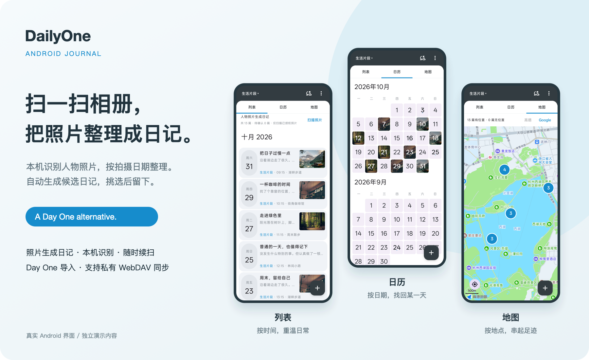
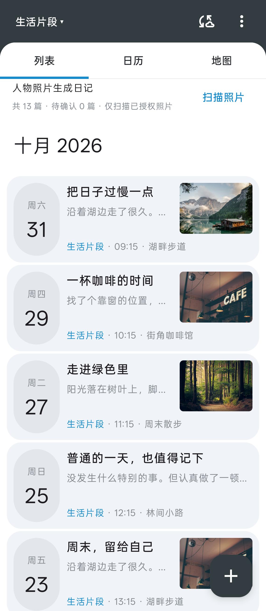
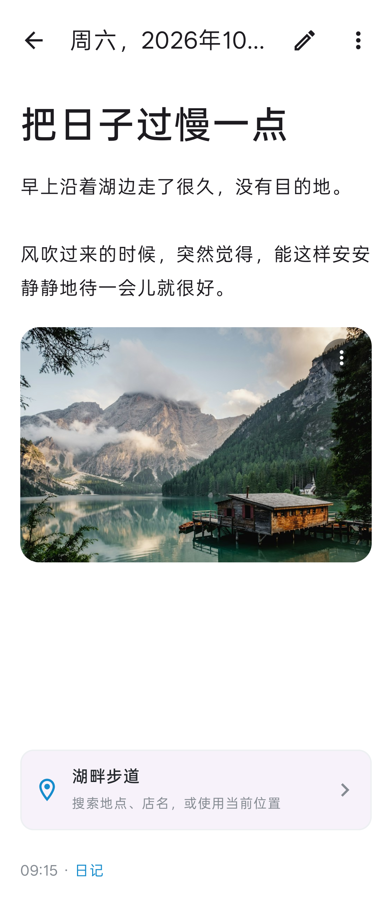
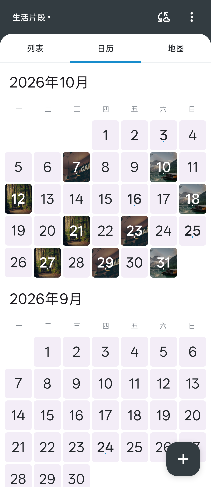
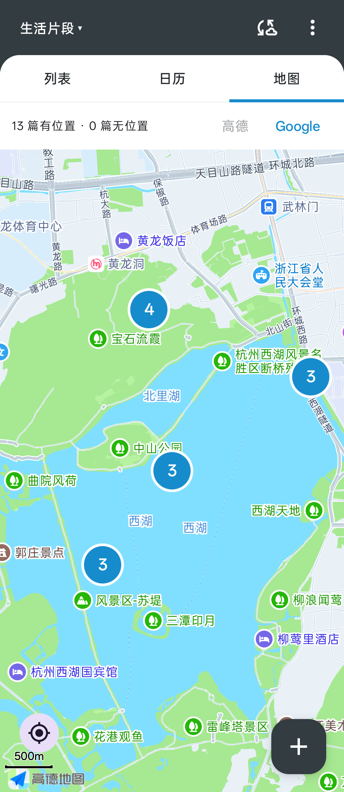
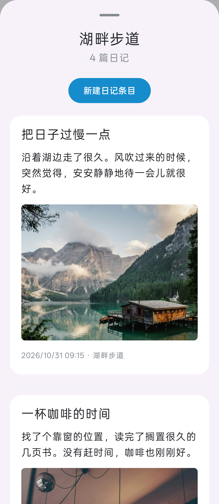

<p align="center">
  
</p>

<h1 align="center">DailyOne</h1>
<p align="center"><strong>A Day One alternative for Android.</strong><br />扫一扫相册，把照片整理成日记。</p>

**相册里已经有很多回忆，日记不必再从空白页开始。** DailyOne 可以在本机扫描人物照片，按拍摄日期自动生成候选日记。挑出想留下的瞬间，再补上当时的心情。

DailyOne 是面向 Android 的 **Day One alternative**：支持文字、照片与视频记录，用列表、日历和地图回顾日常，并支持私有 WebDAV 同步。

从 Day One 迁移时，可以连同日记本、原始照片、视频和日期一起导入，让过去的记录继续留在身边。

推荐搭配支持 WebDAV 的[坚果云](https://www.jianguoyun.com/)使用，使用自己的坚果云账号保存和同步日记。



<p align="center">真实 Android 界面 · 独立演示日记 · <a href="docs/screenshots.md">查看完整截图</a></p>

## 重点功能：扫描照片，自动生成日记

拍了很多照片，却一直没空整理？让 DailyOne 先把相册中的人物照片按日期归入候选日记，你只需决定哪些值得留下。

1. **扫描相册**：从列表或设置启动扫描，读取你授权的照片，在手机本机检测人物照片。
2. **按日期自动整理**：根据拍摄时间逐步生成候选日记，边扫描边显示；拍摄日期无法确定时，提示你确认。
3. **挑选并留下**：候选带有红色蒙版，左滑保留为正式日记，右滑删除；也可打开查看、补充文字或调整照片，再保存。

**随时停，接着整理。** 扫描可停止，已生成的候选保留；再次扫描会跳过已处理且未变化的照片，适合分次整理积累的回忆。

**照片识别在本机完成。** 不上传照片进行人物检测，不识别人物身份；扫描和删除候选均不删除系统相册原图。候选转为正式日记后才参与云同步。更多规则见[人物照片扫描说明](docs/photo-scan.md)。

## 为什么选择 DailyOne

| 从照片开始写日记 | 换个方式回顾 | 支持私有 WebDAV 同步 |
| --- | --- | --- |
| 扫描人物照片，按拍摄日期生成候选日记，挑选保留后再补充文字。 | 列表看日常，日历找某天，地图找去过的地方。 | 离线写作、保留原始媒体，通过私有 WebDAV 按需同步，推荐搭配坚果云使用。 |

**接着写，也能接着看。** 多日记本整理不同主题；从日历或地图进入集合、打开单篇后返回，继续停在原来的月份、地图视野和卡片位置。

<details>
<summary>展开五张应用截图</summary>

| 日常时间线 | 图文日记 | 照片日历 |
| :---: | :---: | :---: |
|  |  |  |

| 足迹地图 | 日记集合 |
| :---: | :---: |
|  |  |

截图使用演示文字和图库照片，来自当前应用组件的实际渲染。截图中的日记地点为演示数据，不代表照片的实际拍摄地。

</details>

## 记录与回顾

- **日记与日记本**：创建、重命名日记本，在全部日记或指定日记本中浏览；可在详情中移动日记。
- **三种回顾视图**：列表、日历和地图共用当前日记本筛选，点击日期或地图标记可展开日记集合。
- **时间线**：按月分组展示卡片、日期、文字摘要与多图预览。长按多选，支持批量删除、合并、预览结果与撤销；跨日记本合并可指定目标日记本。
- **写作**：独立阅读与编辑状态，自动保存，修改日记日期和时间，浅色与深色界面。
- **照片**：多选添加，按比例组合排版，移除与排序；纯照片日记可长按拖动排序、边缘自动滚动。全屏翻页、双击或捏合缩放，通过系统分享面板分享当前原图。
- **视频**：添加视频、查看缩略图并在应用内播放；含视频的日记可通过上移、下移调整媒体顺序。播放能力取决于设备支持的编码。
- **拍摄时间**：添加图片时可选择使用拍摄时间作为日记时间，并记住选择；多选使用第一张有有效时间的图片。
- **原始媒体**：图片复制到应用私有目录，不缩放、不重新编码，保留格式、分辨率和可读取的 EXIF；每篇不设照片数量上限。视频也保留原文件。

## 日历与地图回顾

在顶部切换「列表 / 日历 / 地图」，查看全部日记或当前选中的日记本。

### 日历

按月展示周一到周日的日期网格，有照片的日期显示缩略图；仅含视频时显示视频缩略图，有多篇日记时显示篇数。默认打开最近有日记的月份，可以上下滚动查看其他月份；日期待确认的候选另有查看入口。

点击日期打开当天的日记集合，空白日期也可直接新建日记，并预填该日期。

### 地图

地图默认以手机当前位置为中心。首次使用需要允许定位权限；优先使用系统最近半小时内的有效位置快速显示地图，再在后台获取新位置。点击左下角定位按钮可回到当前位置；后台刷新不会覆盖已经手动拖动的视野。没有可用定位时提示原因，并回退到日记位置。

带位置的日记按地图缩放级别聚合，数字表示日记篇数，放大后拆开附近的标记；相同位置的日记仍可一起查看。坐标批量转换、标记分批显示，切换视图时复用当前页面的坐标转换缓存。没有位置的日记计入提示数量，仍可从列表和日历查看。

地图浏览支持高德与 Google 切换，沿用已有地图配置和高德地图隐私确认。

### 日记集合

点击日期或地图标记，会弹出可滚动的卡片集合，展示标题、正文摘要、首张照片或视频缩略图、时间与地点。点击卡片进入单篇日记；也可新建条目，预填所选日期或地点。退出未编辑的空白草稿不会留下记录。

## 地点与地图

照片 GPS 可用于日记位置，并尝试解析名称与地址。全屏地图支持拖动选点、关键词搜索、附近地点、城市筛选和自定义地点名称，确认后才保存到日记。

- 中国大陆、香港、澳门默认使用高德；其他地区使用 Google。选点时可手动切换服务。
- 高德附近地点支持滚动加载；Google 附近地点每次最多返回 20 条，可通过移动地图或搜索查找更多地点。
- 支持批量重新更新已有日记当前位置的店铺信息，目前限高德地区；保留原始坐标、文字、日期和媒体顺序，以及自定义名称。

地图与地点查询需要网络及有效服务配置。当前用户设置不提供地图密钥输入，已有本机配置继续加密保存并使用；Google 原生地图密钥在构建时注入，且设备需要可用的 Google Play 服务。开发配置、坐标系和服务行为见[地点服务说明](docs/place-services.md)；其中早期版本的设置入口描述以当前应用界面为准。

## 从 Day One 迁移

1. 准备已解压的 Day One JSON 导出目录，保留各日记本 JSON、`photos` 和 `videos`。
2. 在设置中选择「导入 Day One 文件夹」，授权访问该目录。
3. 查看预检中的新增日记、重复日记和缺失媒体数量，再开始导入。

导入保留日记本、创建与修改时间、日记位置、媒体原文件及顺序。正文使用可读文本，Markdown 一级标题转为日记标题；富文本、天气、来源等原始元数据保留在导入 JSON 归档中，不作为完整编辑功能呈现。

重复导入按原始 UUID 跳过，保留已修改或已删除记录，不覆盖日记和已重命名的日记本。缺失媒体会跳过，日记自身的位置保留；复制媒体时校验导出提供的 MD5，日记与日记本通过数据库事务写入，失败可重试。

原始 JSON 和批次清单存于应用私有目录 `files/imports/`，**导入归档不参与云同步**。请保留原始导出目录。

## 支持私有 WebDAV 同步

日记先保存到本机，离线也可阅读与编辑。需要多设备同步时：

1. 在支持 WebDAV 的服务上准备一个已有目录，使用 HTTPS 地址和应用专用密码。
2. 打开应用设置，填写服务器地址、用户名和密码并保存。
3. 返回列表点击「立即同步」。其他 Android 设备使用相同配置并手动同步。

### 推荐服务：坚果云

坚果云支持 WebDAV，可作为 DailyOne 的同步存储。在坚果云「账户信息 → 安全选项 → 第三方应用管理」中，为 DailyOne 生成应用密码，再填写：

| 配置项 | 填写内容 |
| --- | --- |
| 服务器地址 | `https://dav.jianguoyun.com/dav/` |
| 用户名 | 坚果云注册账号 |
| 密码 | 为 DailyOne 生成的第三方应用密码，不是账号登录密码 |

操作步骤见[坚果云官方 WebDAV 授权说明](https://help.jianguoyun.com/?p=2064)，服务地址参见[官方连接示例](https://help.jianguoyun.com/?p=2622)。

### 同步目录与格式

应用在所填目录下创建以下结构：

```text
DailyOne/
├── entries/     # 日记 JSON 与删除标记
├── notebooks/   # 日记本元数据
└── photos/      # 照片和视频原文件
```

同步支持上传、下载与冲突副本。两端同时修改时保留本地冲突副本，再接收云端版本；删除通过标记传播，不物理清除云端媒体。当前只支持手动同步，同步期间列表暂不可编辑，网络失败后可重试。

服务需要支持 `MKCOL`、`PROPFIND`、`GET`、`PUT`、强 ETag 和 `If-Match` / `If-None-Match` 条件写入。请填写最终 WebDAV 地址，应用不会自动跟随重定向；同步格式不兼容 Joplin。不要手动修改同步目录内的文件。

日记文档当前为版本 2，兼容读取版本 1；涉及日记本或视频时，其他设备也应升级到支持版本 2 的客户端。

## 数据与当前边界

- 日记和媒体保存在本机 SQLite 数据库及应用私有目录。卸载应用会删除本地数据，请事先完成同步并保留原始导出文件；系统自动备份已关闭。
- WebDAV 凭据使用 Android Keystore 的 AES-GCM 密钥加密保存。HTTPS 加密传输，日记**尚未实现端到端加密**，云存储服务可读取同步内容。
- 人物照片检测在本机运行；地图、地点查询和 WebDAV 同步会访问相应外部服务。
- 当前没有本地导出、全文搜索、提醒、订阅或账号后台。
- Day One 导入用于迁移，不提供与 Day One 服务之间的双向同步。

## 本地开发

最低支持 **Android 8.0（API 26）**。开发环境使用 **JDK 17**、Android SDK Platform 35；Android Studio 可直接打开仓库。通过 `ANDROID_HOME` 或 `local.properties` 中的 `sdk.dir` 配置 SDK。

```sh
# 日常打包
./gradlew assembleDebug

# 完整验证：单元测试、Lint、调试包
./gradlew testDebugUnitTest lintDebug assembleDebug
```

APK 输出到 `app/build/outputs/apk/debug/app-debug.apk`。优先在本地构建和验证，保留 Gradle 缓存，通常无需 `clean`。仓库包含 Gradle Wrapper 8.9，GitHub Actions 在提交与 PR 后执行自动检查，构建产物名为 `dailyone-debug`。

单元测试覆盖日记与媒体格式、导入文本、日历日期分组与闰年、地图聚合、坐标批量转换、WebDAV 条件写入和冲突处理等；设备测试位于 `app/src/androidTest/`，包括日历日期选择和集合卡片点击测试。上面的完整验证命令不包含设备测试，真实网盘、地图服务及设备媒体播放仍需单独联调。

### 调试安装签名

CI 使用临时调试密钥。为让手机上的后续开发版本可覆盖升级，使用本机持久化调试密钥重新签名，再安装：

```sh
scripts/sign-debug.sh input.apk output.apk
```

脚本使用 `~/.android/debug.keystore`，需配置 `JAVA_HOME` 与 `ANDROID_HOME`，不上传或提交密钥。不同签名不能直接覆盖安装，首次迁移请先备份日记，避免卸载丢失本地数据。此签名仅用于开发测试。

### 设计资源

图标延续蓝底白色日记本的设计，调整轮廓圆角、书脊和留白比例。矢量源文件为 [`design/icon.svg`](design/icon.svg)，Android 使用自适应图标，并提供 Android 13 及以上主题图标。

[`design/prototype.html`](design/prototype.html) 与 [`design/index.html`](design/index.html) 为浏览器设计原型，其数据独立于 Android 应用。
