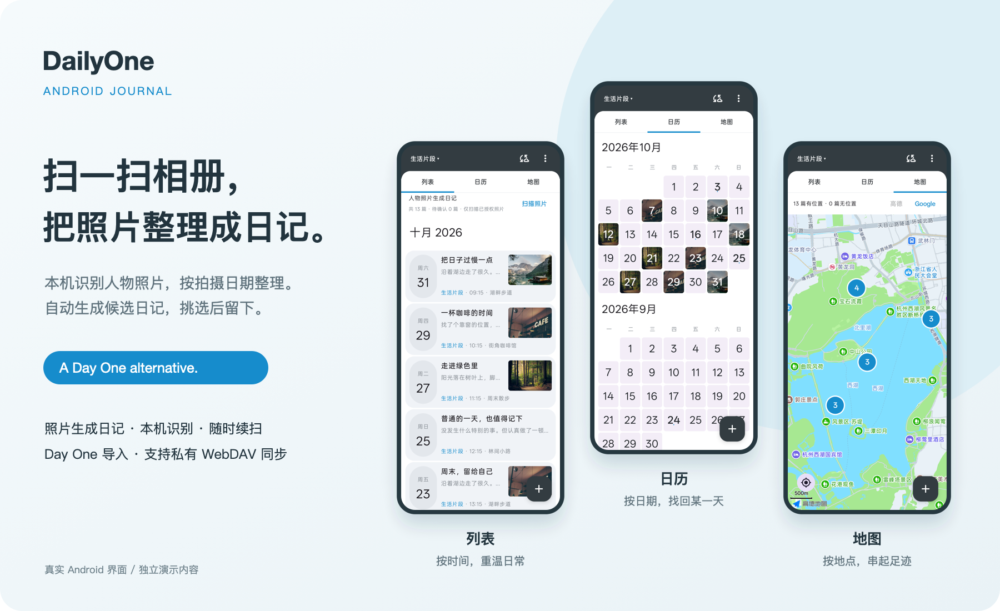
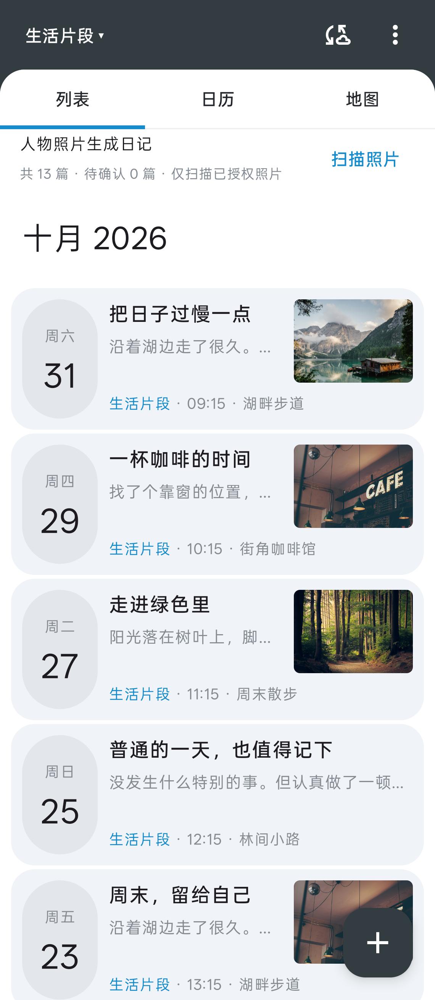
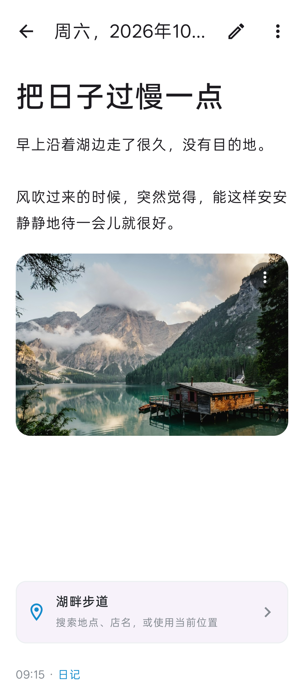
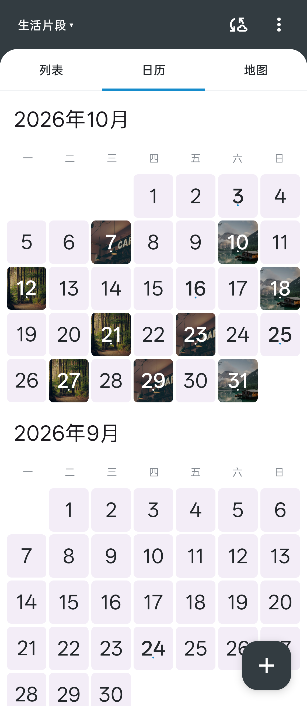
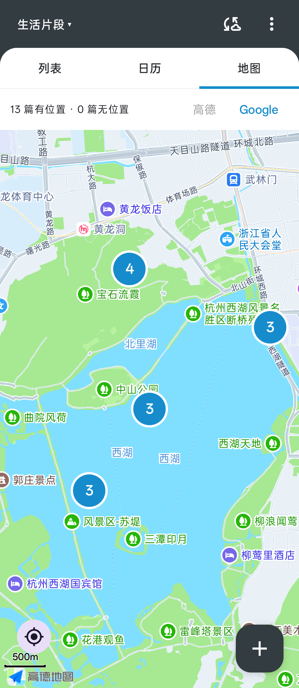
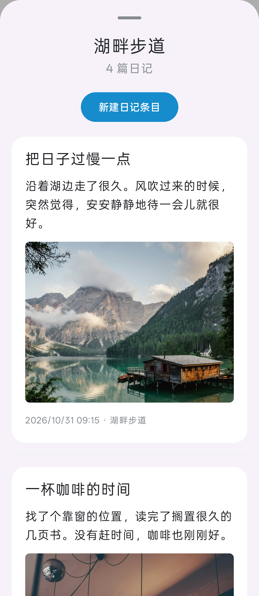

# DailyOne 应用截图

当前 Android 应用组件的真实渲染，使用独立演示日记和图库照片；不读取或修改个人日记数据库，不连接 WebDAV。地点采用公开坐标，演示地点不代表图库照片的实际拍摄地。

## 扫描人物照片，把回忆整理成日记



## 按时间，找回当时的心情



## 文字和照片，一起留下来



## 一个月的日常，一眼看见



## 在地图上，重走那些日子



## 同一天、同一地点，展开来看



## 参考与表达取舍

参考 [Day One 官网](https://dayoneapp.com/) 与 [App Store 介绍和截图](https://apps.apple.com/us/app/day-one-daily-journal-diary/id1044867788)，于 2026-11-01 核对。

| 参考中的表达方式 | DailyOne 的呈现 |
| --- | --- |
| 官网先讲记录和回顾的用途，再展开能力 | 首屏重点介绍人物照片扫描、按日期生成候选日记，再说明回顾与同步 |
| 产品界面配合简短文案，减少首屏说明负担 | 三视图概览图，加五张可查看原图的真实 Android 截图 |
| App Store 首图使用获奖和媒体背书 | 展示 DailyOne 已实现的界面和用途，不使用其他产品的荣誉或评价 |
| 多媒体、日记本、回顾和数据安全分别介绍 | 突出图文视频、多日记本、日历地图、Day One 导入与私有 WebDAV 同步 |

Day One 的音频、回忆提醒、端到端加密等能力没有写作 DailyOne 的已实现功能；DailyOne 的限制与凭据保护方式见主 README。

## 重新生成概览图

五张原始界面截图保存在 `docs/images/screenshots/`。在 macOS 上运行以下命令，可从这些截图重新生成 README 使用的概览图：

```sh
python3 scripts/render-showcase.py
```

脚本使用 macOS 的 Quick Look 与 Swift/ImageIO 导出 PNG，仅为截图排版，屏幕内保持原有界面。演示照片来源及许可见 [素材说明](images/CREDITS.md)。
